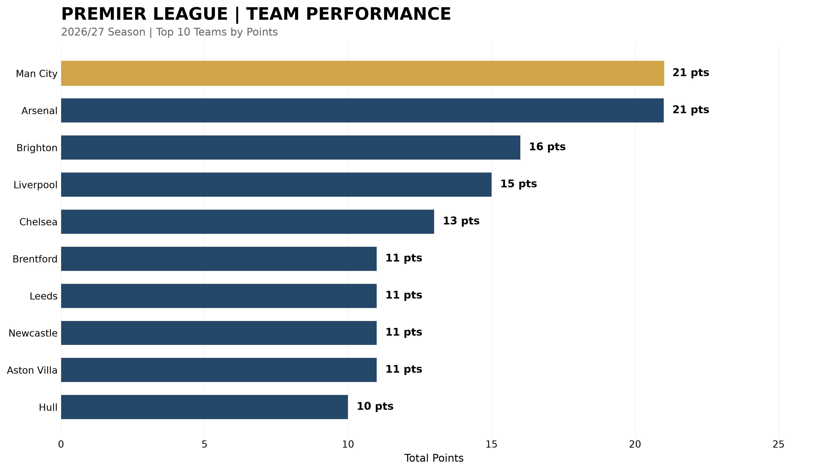
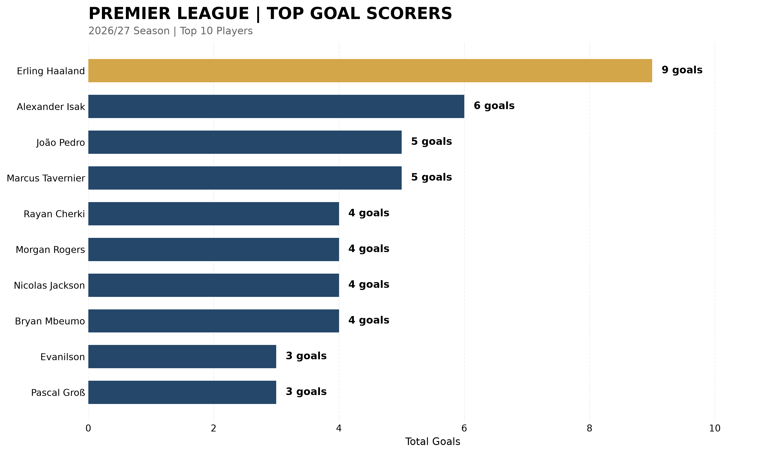
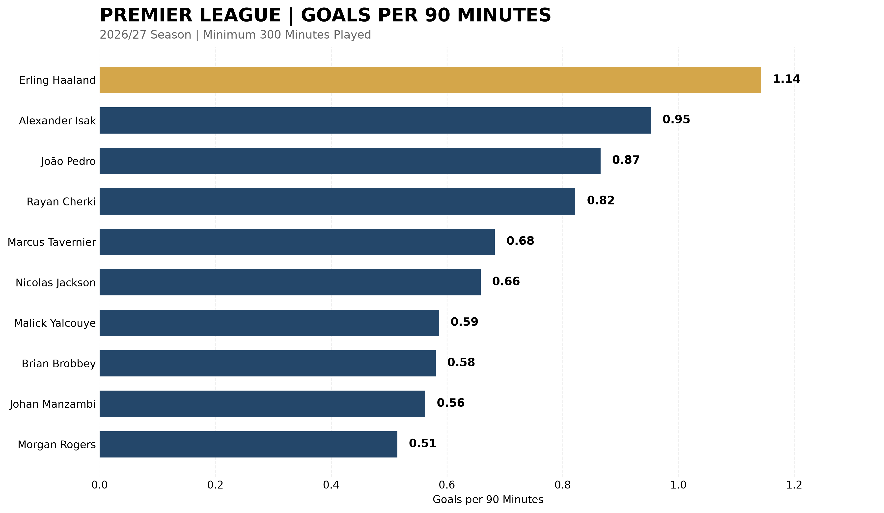

# Football Performance Analysis

A Python data analysis project exploring Premier League 2026/27 match statistics.

## Project Overview

This project uses Python to analyze football match results, calculate league standings, and visualize team performance.

## Technologies Used

- Python
- Pandas
- Matplotlib
- Visual Studio Code

## Features

- Import football match data from CSV files
- Calculate league standings
- Analyze wins, draws, losses, and goals
- Visualize team points
- Compare match results across two datasets

## Project Files

- `analysis.py` - Main analysis script
- `verify_data.py` - Dataset comparison
- `premier_league_2026_27.csv` - Match dataset
- `league_table.csv` - Calculated standings
- `premier_league_chart.png` - Data visualization

## Data Sources and Validation

The project uses match data from:

- open-matchday (GitHub)
- Football-Data.co.uk

Validation performed:
- 80 matches matched across both CSV datasets.
- 0 differences in full-time scores.
- 0 unmatched fixtures.

Additional reference:
- RTÉ Sport Premier League results.

Limitations:
- Matching CSV datasets may share an upstream provider.
- Independent verification of every match is still pending.
- Player-level statistics are not included in this dataset.

## Project Status

Work in progress. Data provenance and accuracy require further verification before the results can be presented as official league statistics.

## Data Visualization

The following chart shows the top 10 teams ranked by points, using goal difference and goals scored as tiebreakers.

**Note:** The chart is based on the downloaded dataset. Official accuracy and source independence have not yet been established.

## Top Goal Scorers

This visualization ranks the top 10 goal scorers in the
2026/27 Premier League dataset.

### Player Statistics

The player analysis includes:

- Goals scored
- Assists
- Minutes played
- Team information
- Performance per 90 minutes

Source: FBref (Sports Reference).

Note: Statistics are based on the downloaded snapshot
and require independent validation before being
presented as officially verified.

## Goals per 90 Minutes

This analysis compares scoring efficiency among Premier League
players who have played at least 300 minutes.

Goals per 90 minutes = (Goals / Minutes played) × 90

### Key Findings

- Erling Haaland leads with 1.14 goals per 90 minutes.
- Alexander Isak follows with 0.95 goals per 90 minutes.
- João Pedro records 0.87 goals per 90 minutes.
- Rayan Cherki scores at a higher rate than Marcus Tavernier,
  despite having fewer total goals.

Results are based on a 2026/27 season data snapshot.

## Data Provenance

This project analyzes Premier League 2026/27 data.

### Match Data
- Sources: open-matchday and Football-Data.co.uk
- Matches analyzed: 80
- Validation: 80 matching fixtures, with no differences in full-time scores between the two datasets.

### Player Data
- Source: FBref (Sports Reference)
- Dataset: Player Standard Stats, Premier League 2026/27
- Original download: sportsref_download.xls
- Records loaded: 456
- Download date: October 26, 2026

### Validation and Limitations
- Selected goal totals were checked against the Premier League website.
- Complete independent verification of all records is pending.
- Results represent a snapshot of the ongoing season.
- Source data redistribution is subject to provider terms.
